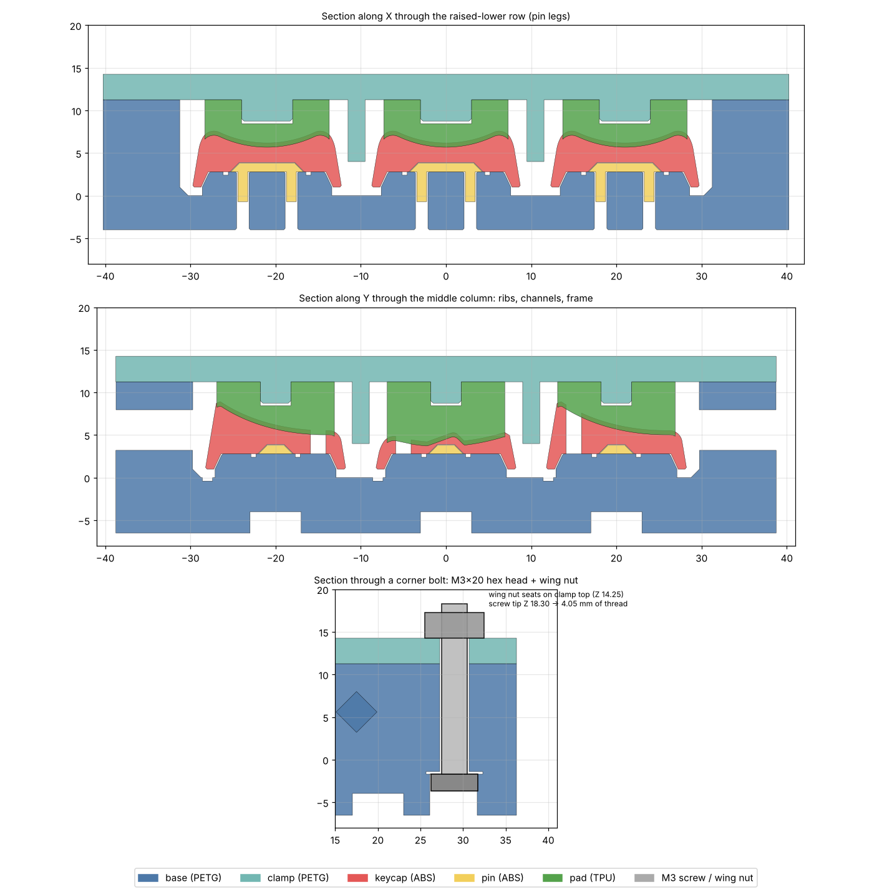
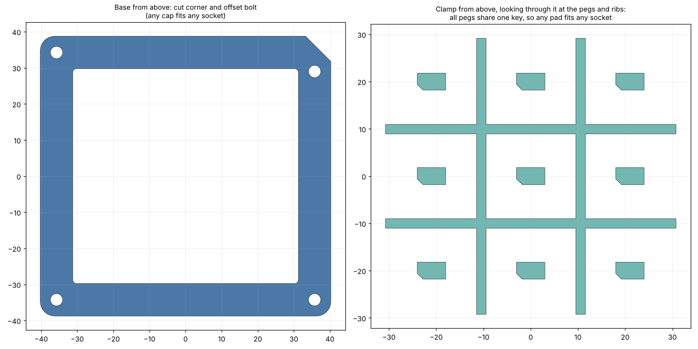

# MKC pin attachment jig

Attaches `pin.stl` to the four MKC V5 keycaps (normal, normal-home, raised-lower, raised-upper), 9 at a time in a 3×3 grid, with the pin's angle, height and position set by the jig instead of by hand.





## How it works

All four V5 keycaps share the same underside: flat at z=1.8 above the rim, with skirt walls drafted about 25°. Only the tops differ. So one universal boss fits every cap, and it does all the locating:

- **Height and angle:** the boss's flat top is the datum. The pin's 8.5×4 base face and the keycap's underside both rest on that same face, so the pin ends up flush with the underside and square to it, the way it is modelled.
- **Position and rotation:** the boss walls match the skirt draft (0.15 mm clearance, chosen from the fit test), so the cap centres itself as it drops on. Two through slots hold the pin legs (0.15 mm clearance per side, chosen from the fit test), so the pin can't twist or slide.
- **Squeeze-out:** a shallow groove around the pin base catches excess slurry so it doesn't lift the cap off the datum.
- **Pressure:** a clamp plate with TPU pads, each shaped to cover its cap's whole top surface, pushes every cap down onto its boss. The clamp bottoms out on a closed frame around the base, so every pad compresses by the same 0.5 mm, whatever the cap type. Each pad covers the whole top, light-bar slot included, and reaches just past the raised crest along each edge, so it seats on the cap like a lid and can't rock. It presses evenly everywhere, even on the sloped raised caps.

## Layout

v4 is a 3×3 grid, which is one Corne half, three columns at a time. A half takes two runs and the whole board takes four.

Every socket is the same, so any cap can go in any of the nine positions. Lay out whatever mix of caps you have, then fit the matching pad above each one: a normal pad over a normal cap, a home pad over a home cap, and a raised pad over a raised-lower or raised-upper cap. All the pads have the same keyed socket, so any pad fits any clamp peg.

## Error-proofing

| Possible mistake | What stops it |
|---|---|
| Clamp turned round or upside down | One bolt (the cut-off corner) sits 5 mm off the corner, so the holes only line up one way. The cut corner on the base and clamp shows you which way. |
| Pad on backwards | The keyed corner on the peg only fits one way. |
| Raised cap under a normal or home pad, or a raised cap turned round | The pad face doesn't match, so the clamp stops several mm above the frame. If you feel resistance before the clamp touches the frame, stop and check. |
| Normal cap under a raised pad, or home vs normal pad mixed up | Not caught physically: the pad just won't press the cap evenly. Check that each pad matches the cap below it before clamping. |

## Parts

| File | Material | Qty | Notes |
|---|---|---|---|
| `pinjig_base.stl` | PETG | 1 | 80.5 × 77.5 mm. Print as exported, bottom down, with no supports. Use the 0.2 mm nozzle, or 0.4 mm with ≤0.12 mm layers, so the leg slots come out accurate. |
| `pinjig_clamp.stl` | PETG | 1 | 3 mm plate with a grid of ribs underneath, which hang down between the caps and pads. Exported top-down with ribs and pegs pointing up, so it prints with no supports and no bridges. |
| `pinjig_pads/pinjig_pad_normal.stl` | TPU 95A | per normal cap | Exported flat back down, with the shaped face on top and the keyed socket open to the bed. Prints without supports; the only bridge is the 3.6 mm socket ceiling. 2 walls, ~15% gyroid, so it stays soft. |
| `pinjig_pads/pinjig_pad_home.stl` | TPU 95A | per home cap | Has a relief for the homing bump. |
| `pinjig_pads/pinjig_pad_raised.stl` | TPU 95A | per raised cap | The same pad works for raised-lower and raised-upper. Their tops match within 0.01 mm, and the pad bridges both light-bar positions. Thinnest point 1.7 mm, at the tall edge. |
| `pinjig_fit_test.stl` | PETG | 1 | Four single bosses at 0.05 / 0.10 / 0.15 / 0.20 mm clearance (1–4 dots). Unchanged since v3, as are all three pads. |

Hardware: 4× M3×20 hex-head screws, fully threaded, and 4× M3 wing nuts.

- Each screw goes in from underneath, at a corner. Its head presses into a hex pocket with three small crush ribs, so it stays put on its own with no glue. If the head won't go in, the ribs printed too tight: reduce `rib_interf`. If it falls out, increase it.
- The head is recessed, so the base sits flat on the table without pushing the screws up.
- With the clamp on, about 4 mm of thread stands above the clamp top for the wing nut. The screw tip stays below a fully seated wing nut.

### How v4 is stiffer

- The clamp is a 3 mm plate, kept thin so a 20 mm screw leaves enough thread for the wing nut. Ribs 2 mm wide and 7 mm deep run between every row and column of caps, about 1.2 mm clear of each cap.
- The span between bolts dropped from about 114 mm to about 72 mm.
- The base has a closed frame on all four sides, and the clamp rests on all of it.

### Airflow

- Diamond vents run through all four sides of the frame. Their 45° edges print without supports.
- The underside has an open channel under each row of leg slots, running out both ends, so the slurry joints breathe from below. The channel roofs are short 6 mm bridges.

### Printing the base

- The only bridges are the 6 mm channel roofs and two thin stepped layers above each screw-head pocket. The steps let the pocket ceiling print flat without drooping into the bolt hole.
- For strength, use 4–5 walls and 40%+ infill. PETG layers bond better at 240–250 °C with the part fan at 30–50%.
- Clean each bolt hole once with a 3.2–3.4 mm drill bit by hand.

## Use

1. Drop a pin into each boss, legs down through the slots. Its base face should sit flat on the boss.
2. Put a thin layer of slurry in the keycap pocket, or on the pin's tapered top.
3. Lower the cap onto the boss and press lightly. The skirt centres it. **Raised caps go tall edge toward the small triangle** engraved in front of each boss.
4. Press the right pad onto each clamp peg. The cut corner of the socket keys it, so a pad only fits one way round.
5. Lower the clamp over the four screws and spin the wing nuts down until the clamp sits on the frame. Finger tight is enough.
6. Leave it clamped for at least an hour, then take the clamp off and lift the caps out. Let them rest overnight before fitting them to a board. These times are starting points, not measured. If a pin leg sticks, push it out from underneath through the slot.

PETG doesn't dissolve in acetone, so ABS slurry won't bond to the jig.

## Tuning

`pin_jig.py` regenerates everything from the current keycap STLs. Run it from this folder:

```
pip install trimesh manifold3d scipy rtree networkx
python3 pin_jig.py .. ../pin.stl .
```

Pads go into `pinjig_pads/`. Add `--preview` to also write an assembled STL with keycaps and pins in place. The main parameters are at the top:

- `boss_clear` and `slot_clear`: set these from the fit-test result. Pick the tightest step where the cap seats fully and rocks with no play, and where a pin drops in under its own weight.
- `pad_interference`: how hard each cap gets pressed. Raise it if caps lift, lower it if pads bulge.
- `cols`, `rows`, `pitch_x`, `pitch_y`: the layout. The default 3×3 base is 80.5 × 77.5 mm.
- `screw_len`, `min_thread`, `clamp_t`: the script stops with an error if a screw of `screw_len` wouldn't leave `min_thread` above the clamp.
- `rib_interf`: how hard the crush ribs grip the screw heads.

## Keycap pocket

The keycap pocket ceiling is at z=2.9, 0.1 mm above the pin's top face. That leaves room for the slurry, so the pin base and the cap underside can both sit flat on the boss.

Pin geometry comes from `keycaps/MKC/pin.stl`, which has the correct 3.5 mm choc legs. The slots go all the way through, so leg length doesn't affect the jig.
