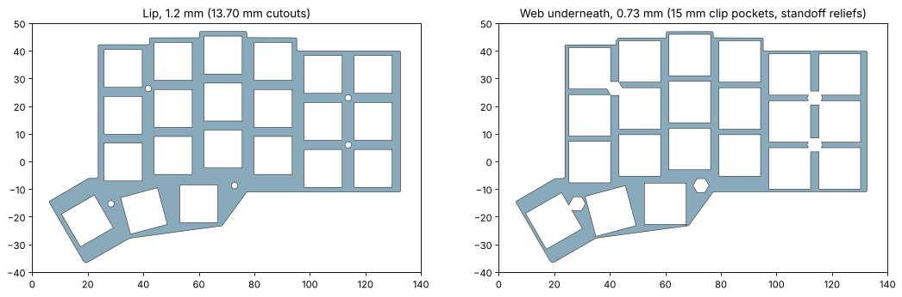
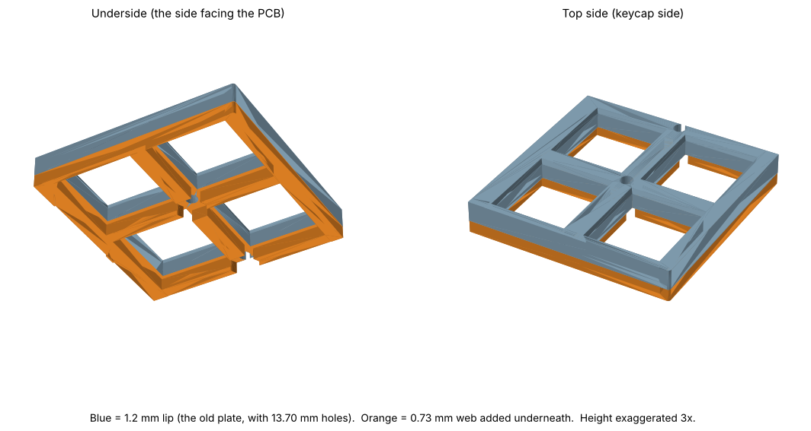
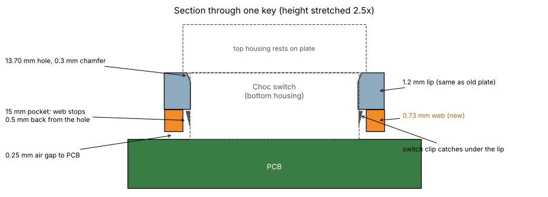

# Thick switch plate (Kailh Choc v1)

A stiffer, print-friendly replacement for `simple-sandwich/switch-plate.stl`.
Some keys on the printed plate look slightly skewed, always at the same
positions. The CAD is not the cause: the plate and PCB line up to within
0.07 mm. The first fit test showed this printer prints holes slightly large
(13.85 drawn measured 13.90), not small, so the cutouts are not squeezing the
switches. The working theory now is that the thin 1.2 mm plate lets
switches lean or turn. This plate adds a stiffening web and lets you pick the
tightest cutout that still seats a switch.







## What changed

| | Old plate | Thick plate |
|---|---|---|
| Cutout | 13.80 mm | **13.70 mm drawn** (snuggest in fit test 2), 0.3 mm chamfer on top |
| Thickness at the cutout | 1.2 mm | 1.2 mm lip (what Choc clips need) |
| Total thickness | 1.2 mm | **1.93 mm**: 0.73 mm web under the lip; where the web runs, up to about 4x stiffer in bending |
| Under each switch | none | 15 × 15 mm pocket so the clips can snap |
| Standoffs | none | 5.25 mm reliefs so the hex standoffs still seat |

Outline, cutout positions and mounting holes are the same as the old plate, so
it drops into the same sandwich with the same screws and standoffs.

### Why not 2–3 mm thicker?

Choc v1 puts the plate top 2.2 mm above the PCB, and the old plate already
used 1.2 mm of that. Only about 1 mm is left between the plate and the PCB,
and the web takes 0.73 mm of it (0.25 mm left for clearance). Going thicker
on top would hit the switch housings and keycaps. Getting more would mean
changing the plate-to-PCB stack, which the switch fixes.

## Printing

- `thick_plate_print_right.stl` / `thick_plate_print_left.stl` are already
  oriented with the plate **top on the bed**. Print as-is, no supports: the
  lip prints first and every pocket and relief opens upward.
- PETG or PLA, 0.2 mm layers or finer, at least 3 perimeters. If your first
  layer squishes a lot, turn on elephant's-foot compensation. The chamfer
  covers about 0.3 mm of it.

## Fit test first

`thick_plate_fit_test.stl` is a small coupon with the same lip and web as the
plate, and five cutouts. The raised dots next to each one give its drawn size:

| Dots | Cutout (drawn) |
|---|---|
| 1 | 13.65 |
| 2 | 13.70 (snuggest in fit test 2, current plate default) |
| 3 | 13.75 |
| 4 | 13.80 (Choc spec, same as the original plate) |
| 5 | 13.85 (best of fit test 1, measured 13.90 printed) |

Pick the smallest hole where a switch clicks in with a light push, sits flat,
and can't be twisted by hand. Set `hole` in `thick_plate.py` to that drawn
size and regenerate.

History: fit test 1 (13.85–14.15) on 2026-10-30. 13.85 was the most secure,
which is why test 2 goes smaller. Fit test 2 (13.65–13.85) on 2026-10-30:
13.70 was the snuggest, so the plate uses 13.70.

## Regenerating

```
cd typeractive/case-designs/thick-plate
python3 thick_plate.py ../simple-sandwich/switch-plate.stl ../../basis/sandwhich-case-and-pcb.stl .
```

Needs `numpy trimesh manifold3d shapely`. The sandwich model (in the
gitignored `basis/`) supplies the standoff and PCB-top keepouts.
`report.json` records the parameters of the last run.

Checked: watertight. The only overlaps with the Typeractive sandwich model
are the screw-head cones at the 5 mounting holes, and the old plate has
those same overlaps.
